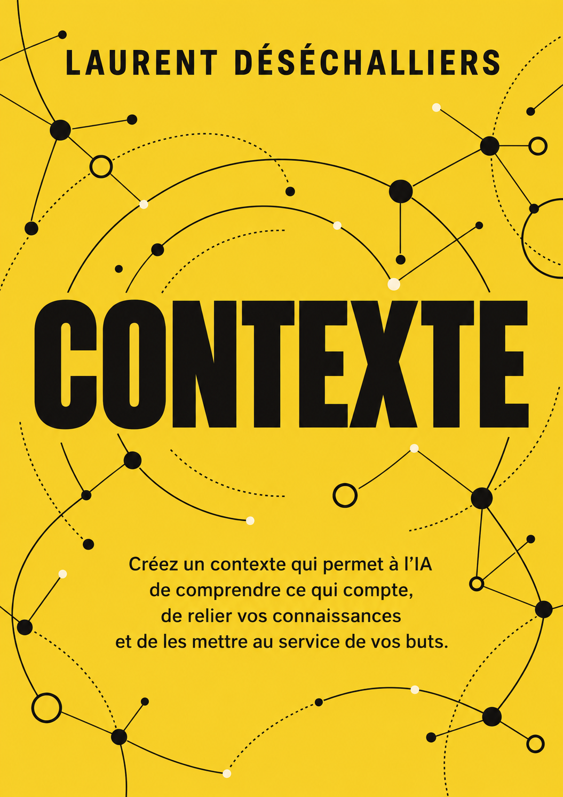
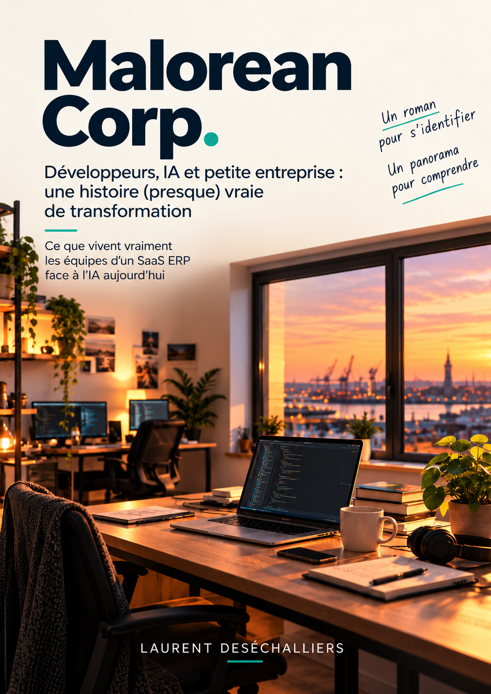

# Publications

Les ouvrages de Laurent Deséchalliers, disponibles en PDF, EPUB, MP3 et Markdown dans 9 langues. Source : [malorean.net](https://malorean.net).

---

## Le Contexte

[Page du livre sur malorean.net](https://malorean.net/le-contexte-le-livre/index.html)

### Français

> Vous avez déjà tout réexpliqué à une IA. Trois fois.
>
> Le but, les sources, ce qui avait été décidé la semaine dernière et pourquoi. Chaque conversation repart de zéro, et le travail d'avant se perd.
>
> Ce livre raconte comment j'ai arrêté. Un espace par sujet, où l'IA sait d'où vient une idée, rappelle un arbitrage, ressort une objection que j'avais moi-même formulée trois semaines plus tôt. Le livrable part chez le client ; le raisonnement reste chez moi.
>
> Et rien ne se perd. Chaque séance laisse derrière elle de la matière reliée et sourcée. Six mois plus tard, un nouveau sujet démarre avec ce que les précédents ont appris. Ce n'est plus un historique, c'est un capital.

[PDF](LIVRE01-LE_CONTEXTE/FR/le-contexte-fr-livre.pdf) · [PDF contraste](LIVRE01-LE_CONTEXTE/FR/le-contexte-fr-livre-contraste.pdf) · [PDF dyslexie](LIVRE01-LE_CONTEXTE/FR/le-contexte-fr-livre-dyslexie.pdf) · [EPUB](LIVRE01-LE_CONTEXTE/FR/le-contexte-fr-livre.epub) · [MP3](LIVRE01-LE_CONTEXTE/FR/le-contexte-fr-livre.mp3) · [Markdown](LIVRE01-LE_CONTEXTE/FR/le-contexte-fr-livre.md)

### English

> You have already explained everything to an AI. Three times over.
>
> The goal, the sources, what was decided last week and why. Every conversation starts from nothing, and the earlier work is lost.
>
> This book is the story of how I stopped. One space per subject, where the AI knows where an idea came from, recalls a trade-off, brings back an objection I had raised myself three weeks earlier. The deliverable goes to the client; the reasoning stays with me.
>
> And nothing is lost. Every session leaves behind material that is connected and sourced. Six months later, a new subject starts with what the earlier ones learned. That is no longer a history — it is capital.

[PDF](LIVRE01-LE_CONTEXTE/EN/le-contexte-en-livre.pdf) · [PDF contraste](LIVRE01-LE_CONTEXTE/EN/le-contexte-en-livre-contraste.pdf) · [PDF dyslexie](LIVRE01-LE_CONTEXTE/EN/le-contexte-en-livre-dyslexie.pdf) · [EPUB](LIVRE01-LE_CONTEXTE/EN/le-contexte-en-livre.epub) · [MP3](LIVRE01-LE_CONTEXTE/EN/le-contexte-en-livre.mp3) · [Markdown](LIVRE01-LE_CONTEXTE/EN/le-contexte-en-livre.md)

### Español

> Ya se lo ha explicado todo a una IA. Tres veces.
>
> El objetivo, las fuentes, lo que se decidió la semana pasada y por qué. Cada conversación empieza de cero, y el trabajo anterior se pierde.
>
> Este libro cuenta cómo dejé de hacerlo. Un espacio por tema, donde la IA sabe de dónde viene una idea, recuerda un arbitraje, saca a la luz una objeción que yo mismo había formulado tres semanas antes. El entregable se va al cliente; el razonamiento se queda conmigo.
>
> Y no se pierde nada. Cada sesión deja tras de sí materia conectada y con su origen. Seis meses después, un tema nuevo arranca con lo que aprendieron los anteriores. Ya no es un historial: es un capital.

[PDF](LIVRE01-LE_CONTEXTE/ES/le-contexte-es-livre.pdf) · [PDF contraste](LIVRE01-LE_CONTEXTE/ES/le-contexte-es-livre-contraste.pdf) · [PDF dyslexie](LIVRE01-LE_CONTEXTE/ES/le-contexte-es-livre-dyslexie.pdf) · [EPUB](LIVRE01-LE_CONTEXTE/ES/le-contexte-es-livre.epub) · [MP3](LIVRE01-LE_CONTEXTE/ES/le-contexte-es-livre.mp3) · [Markdown](LIVRE01-LE_CONTEXTE/ES/le-contexte-es-livre.md)

### Deutsch

> Sie haben einer KI schon alles erklärt. Dreimal.
>
> Das Ziel, die Quellen, was letzte Woche entschieden wurde und warum. Jedes Gespräch beginnt bei null, und die Arbeit von vorher geht verloren.
>
> Dieses Buch erzählt, wie ich damit aufgehört habe. Ein Raum pro Thema, in dem die KI weiß, woher eine Idee stammt, an eine Abwägung erinnert, einen Einwand hervorholt, den ich selbst drei Wochen zuvor formuliert hatte. Das Ergebnis geht zum Kunden; die Überlegung bleibt bei mir.
>
> Und nichts geht verloren. Jede Sitzung hinterlässt Material, das verbunden und belegt ist. Sechs Monate später beginnt ein neues Thema mit dem, was die vorherigen gelernt haben. Das ist keine Historie mehr, das ist Kapital.

[PDF](LIVRE01-LE_CONTEXTE/DE/le-contexte-de-livre.pdf) · [PDF contraste](LIVRE01-LE_CONTEXTE/DE/le-contexte-de-livre-contraste.pdf) · [PDF dyslexie](LIVRE01-LE_CONTEXTE/DE/le-contexte-de-livre-dyslexie.pdf) · [EPUB](LIVRE01-LE_CONTEXTE/DE/le-contexte-de-livre.epub) · [MP3](LIVRE01-LE_CONTEXTE/DE/le-contexte-de-livre.mp3) · [Markdown](LIVRE01-LE_CONTEXTE/DE/le-contexte-de-livre.md)

### Italiano

> Hai già rispiegato tutto a un'IA. Tre volte.
>
> L'obiettivo, le fonti, ciò che era stato deciso la settimana scorsa e perché. Ogni conversazione riparte da zero, e il lavoro precedente va perduto.
>
> Questo libro racconta come ho smesso. Uno spazio per argomento, in cui l'IA sa da dove viene un'idea, ricorda un arbitrato, riporta a galla un'obiezione che avevo formulato io stesso tre settimane prima. Il risultato va al cliente; il ragionamento resta con me.
>
> E nulla si perde. Ogni sessione lascia dietro di sé materia collegata e documentata. Sei mesi dopo, un nuovo argomento parte da ciò che i precedenti hanno imparato. Non è più uno storico: è un capitale.

[PDF](LIVRE01-LE_CONTEXTE/IT/le-contexte-it-livre.pdf) · [PDF contraste](LIVRE01-LE_CONTEXTE/IT/le-contexte-it-livre-contraste.pdf) · [PDF dyslexie](LIVRE01-LE_CONTEXTE/IT/le-contexte-it-livre-dyslexie.pdf) · [EPUB](LIVRE01-LE_CONTEXTE/IT/le-contexte-it-livre.epub) · [MP3](LIVRE01-LE_CONTEXTE/IT/le-contexte-it-livre.mp3) · [Markdown](LIVRE01-LE_CONTEXTE/IT/le-contexte-it-livre.md)

### Português (Brasil)

> Você já explicou tudo a uma IA. Três vezes.
>
> O objetivo, as fontes, o que ficou decidido na semana passada e por quê. Cada conversa recomeça do zero, e o trabalho anterior se perde.
>
> Este livro conta como parei com isso. Um espaço por assunto, em que a IA sabe de onde vem uma ideia, lembra um arbitramento, traz de volta uma objeção que eu mesmo havia formulado três semanas antes. O entregável vai para o cliente; o raciocínio fica comigo.
>
> E nada se perde. Cada sessão deixa material conectado e com sua origem. Seis meses depois, um novo assunto começa com o que os anteriores aprenderam. Já não é um histórico: é um capital.

[PDF](LIVRE01-LE_CONTEXTE/PT-BR/le-contexte-ptbr-livre.pdf) · [PDF contraste](LIVRE01-LE_CONTEXTE/PT-BR/le-contexte-ptbr-livre-contraste.pdf) · [PDF dyslexie](LIVRE01-LE_CONTEXTE/PT-BR/le-contexte-ptbr-livre-dyslexie.pdf) · [EPUB](LIVRE01-LE_CONTEXTE/PT-BR/le-contexte-ptbr-livre.epub) · [MP3](LIVRE01-LE_CONTEXTE/PT-BR/le-contexte-ptbr-livre.mp3) · [Markdown](LIVRE01-LE_CONTEXTE/PT-BR/le-contexte-ptbr-livre.md)

### 日本語

> AIに、もう何度も一から説明し直してきたはずです。三回も。
>
> 目的、資料、先週なにをなぜ決めたのか。会話は毎回ゼロから始まり、それまでの仕事は失われていきます。
>
> 本書は、私がそれをどうやってやめたかの物語です。テーマごとにひとつの場所があり、そこではAIが、あるアイデアの出どころを知り、下した判断を思い出させ、三週間前に私自身が出した反論を掘り起こしてくれます。成果物は顧客のもとへ渡り、考えの筋道は私の手もとに残ります。
>
> そして、何も失われません。 どのセッションも、互いにつながり出典のはっきりした素材を残します。半年後、新しいテーマは、それまでのテーマが学んだことを携えて始まります。それはもはや履歴ではなく、資産です。

[PDF](LIVRE01-LE_CONTEXTE/JA/le-contexte-ja-livre.pdf) · [PDF contraste](LIVRE01-LE_CONTEXTE/JA/le-contexte-ja-livre-contraste.pdf) · [PDF dyslexie](LIVRE01-LE_CONTEXTE/JA/le-contexte-ja-livre-dyslexie.pdf) · [EPUB](LIVRE01-LE_CONTEXTE/JA/le-contexte-ja-livre.epub) · [MP3](LIVRE01-LE_CONTEXTE/JA/le-contexte-ja-livre.mp3) · [Markdown](LIVRE01-LE_CONTEXTE/JA/le-contexte-ja-livre.md)

### 한국어

> 이미 AI에게 모든 것을 다시 설명하셨죠. 세 번이나.
>
> 목표, 자료, 지난주에 무엇을 왜 결정했는지. 대화는 매번 처음부터 다시 시작되고, 앞서 한 작업은 사라집니다.
>
> 이 책은 제가 그 일을 어떻게 멈췄는지에 대한 이야기입니다. 주제마다 하나의 공간이 있고, 그곳에서 AI는 아이디어가 어디서 왔는지 알고, 내렸던 판단을 상기시키며, 제가 3주 전에 직접 제기했던 반론을 다시 꺼내 줍니다. 결과물은 고객에게 가고, 그 추론은 제 곁에 남습니다.
>
> 그리고 아무것도 사라지지 않습니다. 모든 세션은 서로 연결되고 출처가 분명한 자료를 남깁니다. 여섯 달 뒤, 새 주제는 앞선 주제들이 배운 것을 안고 시작합니다. 이제 그것은 기록이 아니라 자산입니다.

[PDF](LIVRE01-LE_CONTEXTE/KO/le-contexte-ko-livre.pdf) · [PDF contraste](LIVRE01-LE_CONTEXTE/KO/le-contexte-ko-livre-contraste.pdf) · [PDF dyslexie](LIVRE01-LE_CONTEXTE/KO/le-contexte-ko-livre-dyslexie.pdf) · [EPUB](LIVRE01-LE_CONTEXTE/KO/le-contexte-ko-livre.epub) · [MP3](LIVRE01-LE_CONTEXTE/KO/le-contexte-ko-livre.mp3) · [Markdown](LIVRE01-LE_CONTEXTE/KO/le-contexte-ko-livre.md)

### 简体中文

> 你已经向 AI 把一切重新解释过了。三次。
>
> 目标、资料、上周做了什么决定以及为什么。每次对话都从零开始，之前的工作随之流失。
>
> 这本书讲的是我如何不再这样做。每个主题一个空间：在那里，AI 知道一个想法从何而来，会提醒我做过的取舍，还会翻出我自己三周前提出的反对意见。交付物交给客户；推理留在我这里。
>
> 而且什么都不会丢失。 每次工作都会留下相互关联、来源清楚的材料。六个月后，一个新主题会带着之前主题学到的东西起步。这不再是历史记录，而是资本。

[PDF](LIVRE01-LE_CONTEXTE/ZH-CN/le-contexte-zhcn-livre.pdf) · [PDF contraste](LIVRE01-LE_CONTEXTE/ZH-CN/le-contexte-zhcn-livre-contraste.pdf) · [PDF dyslexie](LIVRE01-LE_CONTEXTE/ZH-CN/le-contexte-zhcn-livre-dyslexie.pdf) · [EPUB](LIVRE01-LE_CONTEXTE/ZH-CN/le-contexte-zhcn-livre.epub) · [MP3](LIVRE01-LE_CONTEXTE/ZH-CN/le-contexte-zhcn-livre.mp3) · [Markdown](LIVRE01-LE_CONTEXTE/ZH-CN/le-contexte-zhcn-livre.md)

---

## Malorean Corp

[Page du livre sur malorean.net](https://malorean.net/livre2-malorean_corp/index.html)

### Français

> Hier, il fallait parfois des semaines pour transformer une idée en prototype. Aujourd’hui, une personne aidée par l’intelligence artificielle peut y parvenir en quelques jours. Ce changement est spectaculaire. Mais le véritable bouleversement pourrait bien se jouer ailleurs : dans la façon dont nous travaillons ensemble.
>
> Que deviennent les métiers quand un développeur peut explorer un besoin client, qu’un responsable produit peut construire lui-même une solution et qu’un commercial peut créer un outil ? Qui prend les décisions ? Qui en assume les conséquences ? Et que reste-t-il des organisations conçues autour de frontières désormais moins nettes ?
>
> Plutôt que de prédire l’entreprise de demain, ce livre examine celles qui expérimentent déjà de nouvelles façons de travailler. En alternance avec ces analyses fondées sur des exemples réels et des recherches, nous suivons Malorean Corp., une entreprise fictive dont les équipes découvrent, parfois avec enthousiasme, parfois avec inquiétude, ce que l’IA change à leur quotidien.
>
> Les outils évoluent plus vite que nos habitudes. La question n’est plus seulement ce que l’IA permet. C’est ce que nous allons en faire.

[PDF](LIVRE02-MALOREAN_CORP/FR/malorean-corp-fr-livre.pdf) · [PDF contraste](LIVRE02-MALOREAN_CORP/FR/malorean-corp-fr-livre-contraste.pdf) · [PDF dyslexie](LIVRE02-MALOREAN_CORP/FR/malorean-corp-fr-livre-dyslexie.pdf) · [EPUB](LIVRE02-MALOREAN_CORP/FR/malorean-corp-fr-livre.epub) · [MP3](LIVRE02-MALOREAN_CORP/FR/malorean-corp-fr-livre.mp3) · [Markdown](LIVRE02-MALOREAN_CORP/FR/malorean-corp-fr-livre.md)

### English

> Not long ago, turning an idea into a prototype could take weeks. Today, someone working with artificial intelligence can do it in just a few days. That is a remarkable change. But the real transformation may lie elsewhere: in how we work together.
>
> What happens to professional roles when a developer can explore a customer need, a product manager can build a solution themselves, and a salesperson can create a tool? Who makes the decisions? Who takes responsibility for the consequences? And what becomes of organisations built around boundaries that are no longer so clear-cut?
>
> Rather than predicting what the company of tomorrow will look like, this book examines businesses already experimenting with new ways of working. Alongside analysis grounded in real-world examples and research, we follow Malorean Corp., a fictional company whose teams discover, sometimes with excitement and sometimes with unease, how AI is changing their day-to-day work.
>
> The tools are evolving faster than our habits. The question is no longer just what AI makes possible. It is what we choose to do with it.

[PDF](LIVRE02-MALOREAN_CORP/EN/malorean-corp-en-livre.pdf) · [PDF contraste](LIVRE02-MALOREAN_CORP/EN/malorean-corp-en-livre-contraste.pdf) · [PDF dyslexie](LIVRE02-MALOREAN_CORP/EN/malorean-corp-en-livre-dyslexie.pdf) · [EPUB](LIVRE02-MALOREAN_CORP/EN/malorean-corp-en-livre.epub) · [MP3](LIVRE02-MALOREAN_CORP/EN/malorean-corp-en-livre.mp3) · [Markdown](LIVRE02-MALOREAN_CORP/EN/malorean-corp-en-livre.md)

### Español

> Hasta hace poco, convertir una idea en un prototipo podía llevar semanas. Hoy, una persona que cuenta con la ayuda de la inteligencia artificial puede conseguirlo en pocos días. El cambio es espectacular. Pero la verdadera transformación podría producirse en otro lugar: en nuestra forma de trabajar juntos.
>
> ¿Qué pasa con las profesiones cuando un desarrollador puede explorar una necesidad de un cliente, un responsable de producto puede construir una solución por sí mismo y un comercial puede crear una herramienta? ¿Quién toma las decisiones? ¿Quién asume sus consecuencias? ¿Y qué queda de las organizaciones diseñadas en torno a unas fronteras que ya no están tan definidas?
>
> En lugar de predecir cómo será la empresa del mañana, este libro examina las que ya están experimentando con nuevas formas de trabajar. Estas reflexiones, basadas en ejemplos reales e investigaciones, se alternan con la historia de Malorean Corp., una empresa ficticia cuyos equipos descubren, a veces con entusiasmo y otras con inquietud, cómo cambia la IA su día a día.
>
> Las herramientas evolucionan más deprisa que nuestras costumbres. La pregunta ya no es solo qué permite hacer la IA. Es qué vamos a hacer nosotros con ella.

[PDF](LIVRE02-MALOREAN_CORP/ES/malorean-corp-es-livre.pdf) · [PDF contraste](LIVRE02-MALOREAN_CORP/ES/malorean-corp-es-livre-contraste.pdf) · [PDF dyslexie](LIVRE02-MALOREAN_CORP/ES/malorean-corp-es-livre-dyslexie.pdf) · [EPUB](LIVRE02-MALOREAN_CORP/ES/malorean-corp-es-livre.epub) · [MP3](LIVRE02-MALOREAN_CORP/ES/malorean-corp-es-livre.mp3) · [Markdown](LIVRE02-MALOREAN_CORP/ES/malorean-corp-es-livre.md)

### Deutsch

> Noch vor Kurzem brauchte man manchmal Wochen, um aus einer Idee einen Prototyp zu machen. Heute kann ein Mensch mithilfe künstlicher Intelligenz dasselbe in wenigen Tagen schaffen. Das ist eine bemerkenswerte Veränderung. Doch der eigentliche Umbruch könnte ganz woanders stattfinden: in der Art, wie wir zusammenarbeiten.
>
> Was wird aus unseren Berufen, wenn ein Entwickler Kundenbedürfnisse erkunden kann, eine Produktverantwortliche selbst eine Lösung entwickeln kann und ein Vertriebsmitarbeiter ein Werkzeug baut? Wer trifft die Entscheidungen? Wer trägt die Folgen? Und was bleibt von Organisationen, deren einst klare Grenzen zunehmend verschwimmen?
>
> Statt vorherzusagen, wie das Unternehmen von morgen aussehen wird, betrachtet dieses Buch Unternehmen, die schon heute neue Arbeitsweisen erproben. Zwischen Analysen, die sich auf reale Beispiele und Forschung stützen, begleiten wir Malorean Corp., ein fiktives Unternehmen, dessen Teams manchmal begeistert, manchmal besorgt entdecken, wie KI ihren Alltag verändert.
>
> Werkzeuge entwickeln sich schneller als unsere Gewohnheiten. Es geht nicht mehr nur darum, was KI möglich macht. Sondern darum, was wir daraus machen.

[PDF](LIVRE02-MALOREAN_CORP/DE/malorean-corp-de-livre.pdf) · [PDF contraste](LIVRE02-MALOREAN_CORP/DE/malorean-corp-de-livre-contraste.pdf) · [PDF dyslexie](LIVRE02-MALOREAN_CORP/DE/malorean-corp-de-livre-dyslexie.pdf) · [EPUB](LIVRE02-MALOREAN_CORP/DE/malorean-corp-de-livre.epub) · [MP3](LIVRE02-MALOREAN_CORP/DE/malorean-corp-de-livre.mp3) · [Markdown](LIVRE02-MALOREAN_CORP/DE/malorean-corp-de-livre.md)

### Italiano

> Fino a poco tempo fa, trasformare un'idea in un prototipo poteva richiedere settimane. Oggi, con l'aiuto dell'intelligenza artificiale, una persona può riuscirci in pochi giorni. È un cambiamento straordinario. Ma la vera trasformazione potrebbe avvenire altrove: nel modo in cui lavoriamo insieme.
>
> Che cosa succede alle professioni quando uno sviluppatore può esplorare le esigenze di un cliente, un responsabile di prodotto può realizzare una soluzione in prima persona e un commerciale può creare uno strumento? Chi prende le decisioni? Chi se ne assume le conseguenze? E che cosa resta delle organizzazioni costruite attorno a confini sempre meno netti?
>
> Invece di cercare di prevedere come sarà l'azienda di domani, questo libro esamina quelle che stanno già sperimentando nuovi modi di lavorare. A queste analisi, basate su esempi reali e ricerche, si alterna la storia di Malorean Corp., un'azienda immaginaria i cui team scoprono, a volte con entusiasmo e altre con preoccupazione, come l'IA stia cambiando il loro lavoro quotidiano.
>
> Gli strumenti evolvono più in fretta delle nostre abitudini. La domanda non è più soltanto che cosa renda possibile l'IA. È che cosa ne faremo.

[PDF](LIVRE02-MALOREAN_CORP/IT/malorean-corp-it-livre.pdf) · [PDF contraste](LIVRE02-MALOREAN_CORP/IT/malorean-corp-it-livre-contraste.pdf) · [PDF dyslexie](LIVRE02-MALOREAN_CORP/IT/malorean-corp-it-livre-dyslexie.pdf) · [EPUB](LIVRE02-MALOREAN_CORP/IT/malorean-corp-it-livre.epub) · [MP3](LIVRE02-MALOREAN_CORP/IT/malorean-corp-it-livre.mp3) · [Markdown](LIVRE02-MALOREAN_CORP/IT/malorean-corp-it-livre.md)

### Português (Brasil)

> Até pouco tempo atrás, transformar uma ideia em protótipo às vezes levava semanas. Hoje, uma pessoa com a ajuda da inteligência artificial pode conseguir isso em poucos dias. Essa mudança é impressionante. Mas a verdadeira transformação talvez aconteça em outro lugar: na maneira como trabalhamos juntos.
>
> O que acontece com as profissões quando um desenvolvedor pode explorar uma necessidade de um cliente, um gestor de produto pode construir uma solução por conta própria e um profissional de vendas pode criar uma ferramenta? Quem toma as decisões? Quem assume as consequências? E o que acontece com as organizações estruturadas em torno de fronteiras que estão cada vez menos nítidas?
>
> Em vez de prever como será a empresa de amanhã, este livro examina empresas que já experimentam novas formas de trabalhar. Alternando essas análises, fundamentadas em exemplos reais e pesquisas, acompanhamos a Malorean Corp., uma empresa fictícia cujas equipes descobrem, às vezes com entusiasmo, às vezes com apreensão, como a IA muda seu dia a dia.
>
> As ferramentas evoluem mais rápido do que nossos hábitos. A questão já não é apenas o que a IA permite fazer. É o que vamos fazer com isso.

[PDF](LIVRE02-MALOREAN_CORP/PT-BR/malorean-corp-ptbr-livre.pdf) · [PDF contraste](LIVRE02-MALOREAN_CORP/PT-BR/malorean-corp-ptbr-livre-contraste.pdf) · [PDF dyslexie](LIVRE02-MALOREAN_CORP/PT-BR/malorean-corp-ptbr-livre-dyslexie.pdf) · [EPUB](LIVRE02-MALOREAN_CORP/PT-BR/malorean-corp-ptbr-livre.epub) · [MP3](LIVRE02-MALOREAN_CORP/PT-BR/malorean-corp-ptbr-livre.mp3) · [Markdown](LIVRE02-MALOREAN_CORP/PT-BR/malorean-corp-ptbr-livre.md)

### 日本語

> 少し前までは、一つのアイデアを試作品にするだけでも、何週間もかかることがあった。今では人工知能に助けられた一人の人間が、わずか数日で実現できる。この変化は驚くべきものだ。しかし、本当の大変革は別のところにあるのかもしれない。私たちが一緒に働く、その方法である。
>
> 開発者が顧客のニーズを調べ、プロダクト責任者が自ら解決策を作り、営業担当者がツールを開発できるようになったとき、職種はどう変わるのか。誰が決めるのか。その結果を誰が引き受けるのか。職種の境界が曖昧になった今、そうした境界を前提に作られた組織はどうなるのだろう。
>
> 本書は未来の企業を予言するのではなく、すでに新しい働き方を試している企業を見つめる。実在する事例や研究に基づく分析と交互に、架空の企業Malorean Corp.の物語が進む。そこでは社員たちが、ときに期待し、ときに不安を抱きながら、AIが日常の仕事をどう変えていくのかを知っていく。
>
> 道具は私たちの習慣よりも速く進化している。問うべきことは、もはやAIに何ができるかだけではない。私たちがそれをどう使っていくかである。

[PDF](LIVRE02-MALOREAN_CORP/JA/malorean-corp-ja-livre.pdf) · [PDF contraste](LIVRE02-MALOREAN_CORP/JA/malorean-corp-ja-livre-contraste.pdf) · [PDF dyslexie](LIVRE02-MALOREAN_CORP/JA/malorean-corp-ja-livre-dyslexie.pdf) · [EPUB](LIVRE02-MALOREAN_CORP/JA/malorean-corp-ja-livre.epub) · [MP3](LIVRE02-MALOREAN_CORP/JA/malorean-corp-ja-livre.mp3) · [Markdown](LIVRE02-MALOREAN_CORP/JA/malorean-corp-ja-livre.md)

### 한국어

> 어제까지만 해도 하나의 아이디어를 프로토타입으로 만드는 데 몇 주가 걸리곤 했습니다. 오늘날에는 인공지능의 도움을 받는 한 사람이 며칠 만에 해낼 수 있습니다. 놀라운 변화입니다. 하지만 진정한 격변은 다른 곳, 바로 우리가 함께 일하는 방식에서 일어날지도 모릅니다.
>
> 개발자가 고객의 필요를 탐색하고, 프로덕트 매니저가 직접 솔루션을 만들며, 영업 담당자가 도구를 만들 수 있게 되면 각 직무는 어떻게 달라질까요? 누가 결정을 내리고, 그 결과를 누가 책임질까요? 그리고 이제 경계가 한층 흐려진 상황에서, 그 경계를 중심으로 설계된 조직은 어떻게 될까요?
>
> 이 책은 미래의 회사를 예측하는 대신, 이미 새로운 업무 방식을 실험하고 있는 기업들을 살펴봅니다. 실제 사례와 연구에 근거한 분석과 번갈아, 가상의 기업 Malorean Corp.의 이야기를 따라갑니다. 그곳의 팀들은 때로는 기대에 차고, 때로는 불안을 느끼며 AI가 일상을 어떻게 바꾸는지 알아갑니다.
>
> 도구는 우리의 습관보다 빠르게 진화합니다. 이제 질문은 AI가 무엇을 가능하게 하는가에 그치지 않습니다. 우리가 그것으로 무엇을 할 것인가입니다.

[PDF](LIVRE02-MALOREAN_CORP/KO/malorean-corp-ko-livre.pdf) · [PDF contraste](LIVRE02-MALOREAN_CORP/KO/malorean-corp-ko-livre-contraste.pdf) · [PDF dyslexie](LIVRE02-MALOREAN_CORP/KO/malorean-corp-ko-livre-dyslexie.pdf) · [EPUB](LIVRE02-MALOREAN_CORP/KO/malorean-corp-ko-livre.epub) · [MP3](LIVRE02-MALOREAN_CORP/KO/malorean-corp-ko-livre.mp3) · [Markdown](LIVRE02-MALOREAN_CORP/KO/malorean-corp-ko-livre.md)

### 简体中文

> 过去，把一个想法变成原型有时需要数周。如今，一个人在人工智能的帮助下，几天内就能做到。这一变化令人瞩目。但真正的巨变也许发生在别处：发生在我们共同工作的方式之中。
>
> 当开发者可以探索客户需求，产品负责人可以亲手构建解决方案，销售人员可以创建工具时，各种职能会发生什么变化？谁作出决定？谁承担后果？那些围绕如今已不再清晰的边界而设计的组织，又会变成什么样？
>
> 本书不试图预测未来的企业，而是考察那些已经开始尝试新工作方式的公司。在这些以真实案例和研究为基础的分析之间，我们还会跟随一家虚构企业 Malorean Corp.，看它的团队如何时而兴奋、时而不安地发现 AI 给日常工作带来的变化。
>
> 工具演进得比我们的习惯更快。问题已不再只是 AI 能做什么，而是我们将用它做什么。

[PDF](LIVRE02-MALOREAN_CORP/ZH-CN/malorean-corp-zhcn-livre.pdf) · [PDF contraste](LIVRE02-MALOREAN_CORP/ZH-CN/malorean-corp-zhcn-livre-contraste.pdf) · [PDF dyslexie](LIVRE02-MALOREAN_CORP/ZH-CN/malorean-corp-zhcn-livre-dyslexie.pdf) · [EPUB](LIVRE02-MALOREAN_CORP/ZH-CN/malorean-corp-zhcn-livre.epub) · [MP3](LIVRE02-MALOREAN_CORP/ZH-CN/malorean-corp-zhcn-livre.mp3) · [Markdown](LIVRE02-MALOREAN_CORP/ZH-CN/malorean-corp-zhcn-livre.md)
